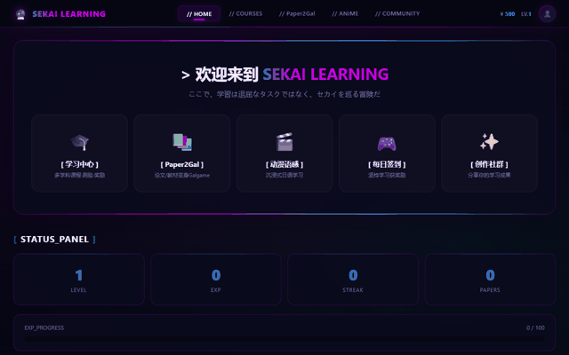

# 馃帗 SekaiLearning 路 浜屾鍏冩父鎴忓寲瀛︿範骞冲彴

> **Spring Boot + Thymeleaf + MyBatis 路 娓告垙鍖栨満鍒?路 绉垎 路 绀剧兢**
> Gamified learning platform with points & community

[](https://www.oracle.com/java/)
[](https://spring.io/projects/spring-boot)
[](https://www.thymeleaf.org/)
[](https://mybatis.org/)
[](https://www.mysql.com/)
[](LICENSE)

鍩轰簬 **Spring Boot + Thymeleaf + MyBatis** 鐨勪簩娆″厓椋庢牸瀛︿範骞冲彴锛岄€氳繃娓告垙鍖栨満鍒舵彁鍗囧涔犲叴瓒ｃ€?
An anime-styled gamified learning platform built with Spring Boot + Thymeleaf + MyBatis.

## 鉁?鍔熻兘 Features

- 浜屾鍏冮鏍肩晫闈?Anime-style UI
- 鑳屽崟璇嶇瓑瀛︿範鍔熻兘 Vocabulary learning
- **娓告垙鍖栧涔犱笌绉垎鏈哄埗** Gamified learning & points
- **鍏磋叮绀剧兢** Interest community

## 馃搻 椤圭洰缁撴瀯 Project Structure

```text
SekaiLearning/
鈹溾攢鈹€ seed/        # 绉嶅瓙鏁版嵁
鈹溾攢鈹€ src/         # 婧愮爜
鈹斺攢鈹€ init.sql     # 鏁版嵁搴撳垵濮嬪寲鑴氭湰
```

## 鈻讹笍 杩愯 Run

```powershell
cd SekaiLearning
mvn spring-boot:run
```

鏁版嵁搴撳瘑鐮侀€氳繃鐜鍙橀噺 `DB_PASSWORD` 娉ㄥ叆銆?
## 馃摑 Notes / 璇存槑

- 鏁版嵁搴撹〃浣跨敤 `sekai_learning_` 鍓嶇紑锛堟暟鎹簱 `sekai_friend`锛?- 鍒濆鍖栬剼鏈細`SekaiLearning/init.sql`

## 馃搫 License

[MIT](LICENSE) 漏 2026 [sekai-lyr](https://github.com/sekai-lyr)


<p align="center">
  
</p>
---

**猸?If this project helped you, star it! 濡傛灉杩欎釜椤圭洰瀵逛綘鏈夊府鍔╋紝娆㈣繋 Star锛?*
